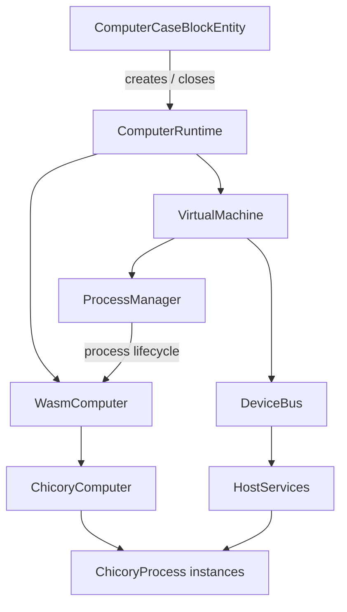

# Architecture

OpenWAC runs WebAssembly firmware and programs inside server-owned computers. The Java core owns machine state, device access, process scheduling, and limits; the Chicory adapter executes WASM; NeoForge connects those pieces to placed blocks, items, world storage, and clients.

This page describes implemented ownership and lifecycle. See [HAL](hal.md) for imports and binary call details, [kernel runtime](kernel-runtime.md) for kernel behavior, and [implementation gaps](implementation-gaps.md) for planned or incomplete work.

## Package ownership

| Package | Responsibility |
| --- | --- |
| `core.machine`, `core.process`, `core.device`, `core.event` | Loader independent state, scheduling, device bus, events, limits, and snapshot values. |
| `runtime` | `WasmEngine`, `WasmComputer`, engine limits, and host service boundary. |
| `runtime.chicory` | WASM validation, interpreter instances, metering, process continuations, and memory adapters. |
| `runtime.hal` | Platform neutral services passed to imports. |
| `service` | Per-computer asynchronous runtime coordinator and file-backed repositories. |
| `integration.neoforge` | Block entity lifecycle, item assembly, persistence, peripheral discovery, menus, and client presentation. |

`MachineService` exists as an index, but the placed computer does not use it to own execution. `ComputerCaseBlockEntity` constructs and owns its `ComputerRuntime` directly. The core does not hold Minecraft world objects.

## Ownership and boot flow

The server tick calls `ComputerRuntime.tick()`. That method admits at most one in-flight turn for the computer and submits it to a shared two-thread worker pool. A rejected submission is dropped until a later tick retries; the Minecraft tick thread does not execute guest code. `VirtualMachine.runTick` runs on that worker and advances `OFF`/`BOOTING`/`RUNNING`/`SLEEPING`/`CRASHED` state.

On first admitted tick, the VM selects the installed `BiosEeprom`, queues its bootloader as a privileged process, and enters `RUNNING`. `ProcessManager` creates processes through the `WasmComputer` lifecycle. Ordinary WASM processes are compiled and instantiated by `ChicoryEngine`, and their `_start` export must have type `() -> ()`. A passive kernel can be installed separately by firmware; it is owned by `ChicoryComputer`, has its own memory, and does not occupy a process slot.

`ProcessManager` owns machine-local process IDs, spawn/kill queues, ready and waiting queues, and lifecycle cleanup. Each tick it applies pending requests and schedules round-robin quanta within `fuelPerTick`; yields and exhausted quanta go to the queue tail. `ChicoryComputer` gives each process a 64-entry mailbox, separate from the VM's 1024-entry event hub.

Closing or unloading the block entity closes its runtime. Close waits for an in-flight worker turn before releasing the machine slot and WASM instances. A server-wide active-machine semaphore allows 16 runtimes. The fixed worker pool has two threads and a queue of 16 tasks; a separate two-thread compiler pool has a queue of 16. Each computer admits one turn at a time. WASM processes are virtual threads, with a global semaphore limiting them to 128.

## Runtime boundary and safety limits

`WasmEngine` and `WasmComputer` isolate Chicory from core types. `ChicoryEngine` copies and checks input module bytes, applies preflight and structure/proposal limits, and only accepts function imports. `ChicoryHostImports` links host functions. `ChicoryProcess` charges interpreter instructions and host work to the active quantum, and parks the continuation at yields or quantum boundaries.

| Bound | Implemented limit or source |
| --- | --- |
| Module bytes | At most 1 MiB (`FirmwareRepository.MAX_MODULE_BYTES` and engine validation). |
| Machine memory | Installed RAM-derived `MachineConfig`, capped at 256 MiB per machine. |
| WASM memory | Initial and grown linear-memory pages charged to both machine and server budgets; server budget is 256 MiB. Shared memory is rejected. |
| Fuel | Up to 1,000,000 per tick; quantum is positive and cannot exceed the tick budget. Defaults: 4,096 fuel/tick and 256/turn. |
| Installed tier-one hardware | CPU: 65,536 fuel/tick, 256/turn, 16 processes. Each RAM module: 1 MiB; four RAM slots. Standalone core defaults above are separate from this item configuration. |
| Processes / devices | `MachineConfig` allows at most 256 processes; `ProcessManager` also enforces its configured limit. Device bus caps attachments at 64. |
| Turn time | A process turn has a 2 second watchdog. Timeout records a failure and interrupts/closes the process; Java thread interruption is not a hard kill guarantee. |
| Chat / runtime admission | Four chat messages per drain interval; 16 active computers, two worker threads, and a 16-entry task queue. |

`BudgetedMemory` reserves initial pages before constructing linear memory and reserves every successful growth at both scopes. Closing releases its reservation. `MemoryBudget` is a page ledger (64 KiB/page), while installed RAM determines the computer capacity. CPU and RAM slots determine execution budgets; privileged import linking controls direct HAL access.

The module profile allows scalar `i32/i64/f32/f64`, at most one linear memory,
and one bounded `funcref` table of at most 4096 entries. Preflight caps encoded
function bodies at 64 KiB total, locals at 1024/function and 65,536/module,
functions/types/globals at 4096 each, and imports at 64. Execution caps the
operand stack at 65,536 values and call depth at 128. SIMD, threads, GC, exception
tags, and passive/reference element segments are rejected.

Device calls resolve a stable device UUID through the machine's synchronized `DeviceBus`, enforce the response limit, and convert device `RuntimeException`s to an error result. Device payload schemas and call numbers belong in [device interfaces](device-interfaces.md). Server world access remains in the NeoForge integration; external peripheral discovery is performed there and attached to the normal device bus.

## Persistence and identity

World reload reconstructs hardware and cold-boots firmware when the saved power intent is on and no failure is recorded. Unloading closes execution; guest stacks and Chicory objects are transient. `VirtualMachine.snapshot()` produces a version-1 diagnostic DTO, while the playable case persists the block-entity record described below.

`ComputerCaseBlockEntity` saves a version-3 record in block-entity data. It persists machine UUID, powered flag, short failure string, inventory item stacks, and up to 16 peripheral links (position plus pinned device UUID). The computer identity and hardware inventory survive reload; process IDs, running state, WASM memory, mailbox contents, and detailed crash reports do not. The BIOS slot is index 9, CPU slot 10, and four RAM slots are 11–14. Loading records older than version 2 moves a BIOS EEPROM from legacy component slots into slot 9 if that slot is empty.

Component item stacks hold device UUIDs, preserving device identity when moved. Disk backing uses world-local `openwac/disks/<uuid>.disk` files; firmware uploads use content-addressed SHA-256 blobs under `openwac/firmware`; importer uploads use immutable hash blobs and per-device `<uuid>.meta` selections under `openwac/imports`. Built-in firmware references resolve to bundled resources. These repositories persist media or artifacts, not a running computer image.

Disks expose raw blocks and geometry. The host stores no root designation; guest firmware and operating systems choose disk roles. The version-1 disk image format is unchanged. Legacy `<uuid>.disk.root` sidecars are ignored and can be removed.

## Data path summary

1. The block entity validates CPU, BIOS, RAM, and component slots; constructs devices and repositories; then creates `ComputerRuntime`.
2. Runtime creates the core machine, host services, memory ledger, and Chicory computer, attaches devices, and requests power-on.
3. A worker turn boots firmware and schedules WASM processes. Imports route through host services to the device bus, event mailbox, or process lifecycle.
4. Worker outcomes, diagnostics, chat, and measured CPU/RAM values are exposed back to the block entity for reporting and screens.
5. Stop/unload closes processes, kernel, memory reservations, and device attachments; saved item data and repository files remain for the next boot.

Implementation: [ComputerCaseBlockEntity.java](../src/main/java/org/mod/openwac/integration/neoforge/blockentity/ComputerCaseBlockEntity.java),
[ComputerRuntime.java](../src/main/java/org/mod/openwac/service/ComputerRuntime.java),
[ProcessManager.java](../src/main/java/org/mod/openwac/core/process/ProcessManager.java),
[ChicoryEngine.java](../src/main/java/org/mod/openwac/runtime/chicory/ChicoryEngine.java),
[WasmPreflight.java](../src/main/java/org/mod/openwac/runtime/chicory/WasmPreflight.java).
